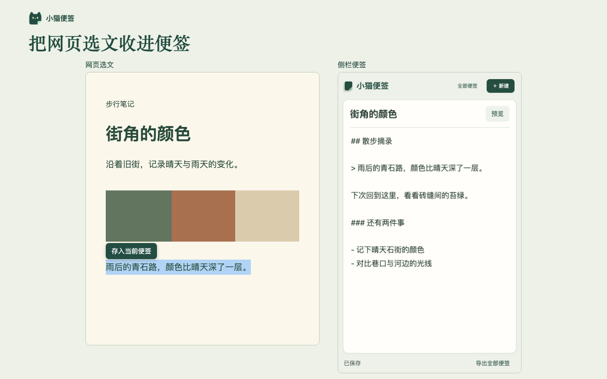
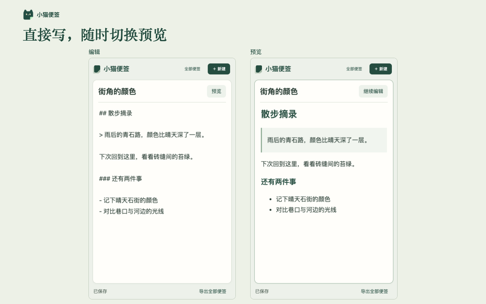
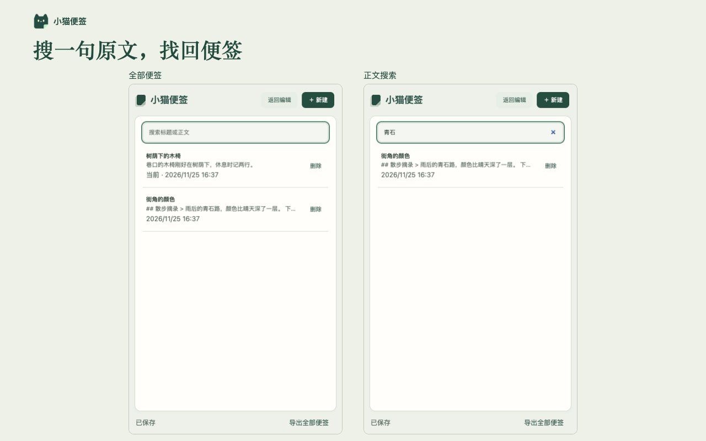

# Kitten Notes · 小猫便签

English · [简体中文](README.zh-CN.md)

Collect passages from different web pages in one note and write Markdown alongside the page. Notes are saved automatically in your browser profile. The extension interface is in Simplified Chinese.

[Install on Microsoft Edge](https://microsoftedge.microsoft.com/addons/detail/gbdkmbpkohjgllliieeoflcpilehceob) · [Install on Chrome](https://chromewebstore.google.com/detail/amcikahiikmpgigcpdpambnknljdiaoe) · [Download the extension ZIP](https://github.com/kiritokun07/kitten-notes/releases/latest)

## From selection to notebook

1. Select text on a web page and click **存入当前便签** (Save to current note) beside the selection or in the context menu. The first clip creates a note. Clips from other pages append to the active note in order. Each note keeps its most recent source URL.
2. Click the cat icon in the browser toolbar to open the side panel. Write alongside your clips and click **预览** (Preview) to see the Markdown formatting. Click **新建** (New) to start another note. It appears in the list once you type or save a clip.
3. Open **全部便签** (All notes) to search titles and text, then select a result to resume editing. **导出全部便签** (Export all notes) downloads one Markdown file per note and a complete `backup.json` in a single ZIP, even when a search is active.

### Clip a passage



### Write and preview Markdown



### Find and export notes



## Install manually

Download the `kitten-notes-VERSION.zip` asset from Releases and extract it. Open `edge://extensions` in Edge or `chrome://extensions` in Chrome. Enable **Developer mode**, click **Load unpacked**, and select the folder containing `manifest.json`. From a source checkout, select `extension/`. No build is required to load the extension.

## Development

With Chrome, Edge and Node.js 18 or later installed, run the end-to-end tests from the repository root. Use Python 3 to build the release ZIP.

```sh
npm ci
NOTES_TEST_BROWSER=chrome npm test
NOTES_TEST_BROWSER=msedge npm test
python3 scripts/package.py
```

The packaging script writes to `release/` and checks each archived file against the extension source.

## Privacy and license

Selected text, notes and the latest source URL stay in the current browser profile. The extension does not upload notes or sync them across devices. [Privacy policy (Chinese)](https://kitten-notes-privacy.pages.dev/) · [Permissions (Chinese)](store/permissions-zh-CN.md)

Original code is licensed under the [MIT License](LICENSE). Bundled libraries retain their [third-party licenses](extension/vendor/LICENSES.txt).
