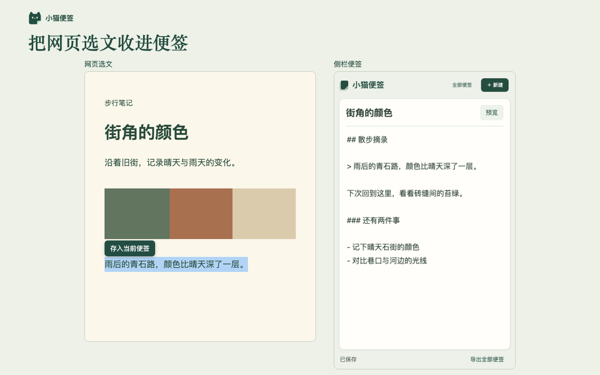
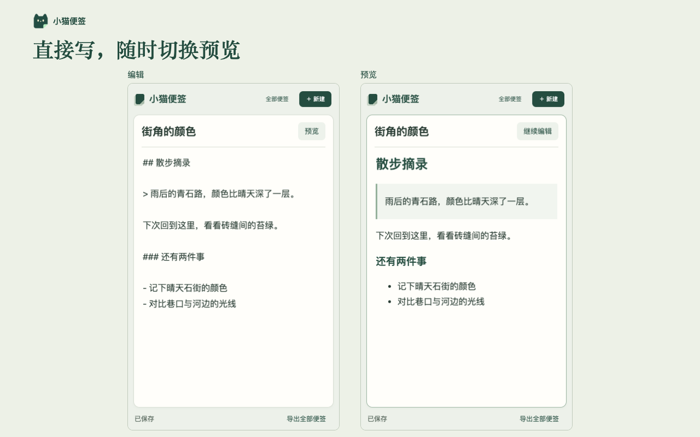
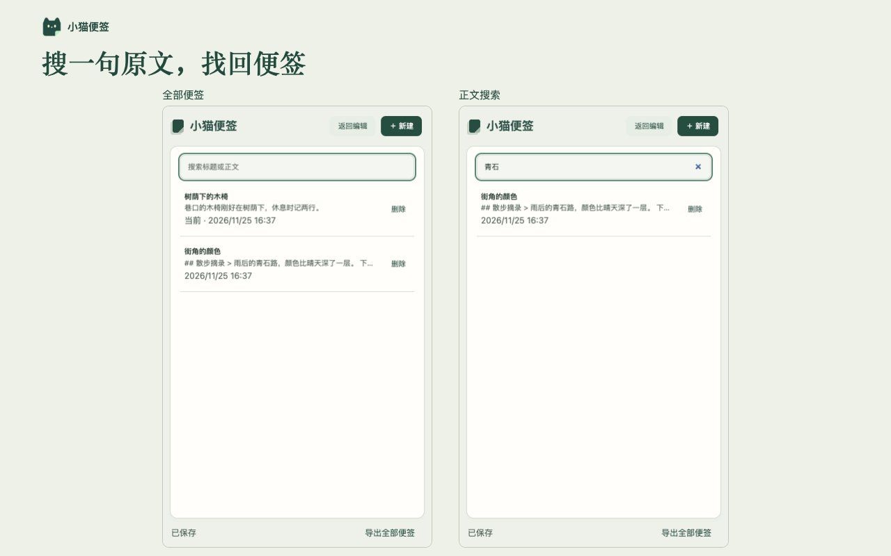

# 小猫便签

[English](README.md) · 简体中文

把不同网页上的选文收进同一张便签，边读边在侧栏写 Markdown。便签自动保存在当前浏览器，无需注册。

[在 Microsoft Edge 安装](https://microsoftedge.microsoft.com/addons/detail/gbdkmbpkohjgllliieeoflcpilehceob) · [下载扩展 ZIP](https://github.com/kiritokun07/kitten-notes/releases/latest)

## 从摘录到导出

1. 在网页上选中一段文字，点击选区旁的「存入当前便签」，也可以使用右键菜单中的同名选项。第一次摘录会自动创建便签。在其他网页继续摘录，选文会依次追加到当前便签。每张便签保留最近一次摘录的来源网址。
2. 点击浏览器工具栏的小猫图标打开侧栏。可以直接写字，或点「预览」查看 Markdown 排版。换个主题时点「新建」，写下第一段文字或摘录后，草稿会出现在列表里。
3. 打开「全部便签」，按标题或正文搜索，点一条结果即可继续编辑。点「导出全部便签」可下载 ZIP，内含每张便签的 Markdown 文件和完整的 `backup.json`。搜索条件不会缩小导出范围。

### 网页划词摘录



### 侧栏编辑与 Markdown 预览



### 搜索与导出



## 手动安装

从 Releases 下载名为 `kitten-notes-版本号.zip` 的扩展包并解压。在 Edge 打开 `edge://extensions`，或在 Chrome 打开 `chrome://extensions`，启用「开发人员模式」，点击「加载解压缩的扩展」，选择直接含有 `manifest.json` 的文件夹。如果使用源码，请选择仓库中的 `extension/`。扩展可直接加载，无需构建。

## 开发与验证

本机安装 Chrome、Edge 和 Node.js 18 或以上版本后，可在仓库根目录运行端到端测试。使用 Python 3 生成发布包。

```sh
npm ci
NOTES_TEST_BROWSER=chrome npm test
NOTES_TEST_BROWSER=msedge npm test
python3 scripts/package.py
```

打包脚本在 `release/` 生成 ZIP，并逐项核对归档内容与扩展源码。

## 隐私与许可

选文、笔记和最近摘录的网址仅保存在当前浏览器配置中。扩展不上传便签，也不在设备间同步。[隐私政策](https://kitten-notes-privacy.pages.dev/) · [权限说明](store/permissions-zh-CN.md)

项目原创代码采用 [MIT 许可证](LICENSE)。随包分发的第三方库保留[各自的许可证](extension/vendor/LICENSES.txt)。
